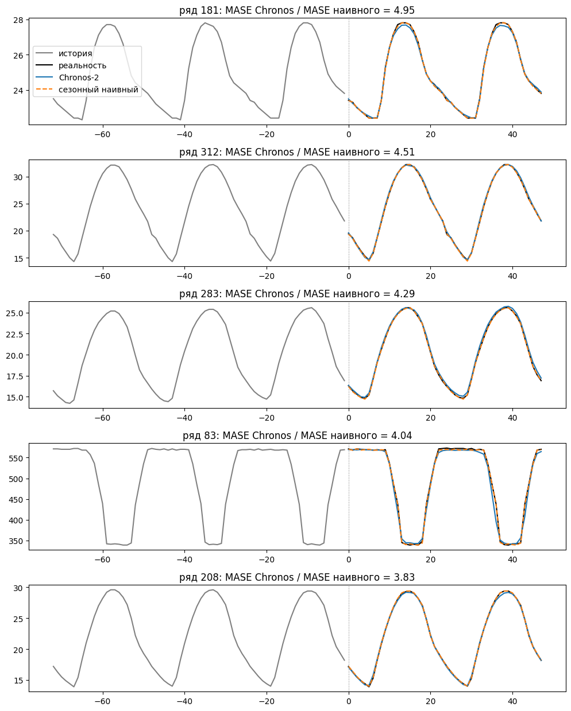

# Chronos-2 против сезонного наивного прогноза на m4 hourly

На каких почасовых рядах zero-shot модель chronos-2 проигрывает сезонному наивному прогнозу?

## Данные и протокол

- **Данные:** 414 почасовых рядов соревнования M4 (`m4_hourly` из gluonts).
- **Тест:** последние 48 часов каждого ряда.
- **Период сезонности:** 24 часа.

## Модели

- **Сезонный наивный прогноз** — повторяет последние сутки истории.
- **Chronos-2** (`autogluon/chronos-2`) — предобученная фундаментальная модель, без дообучения (zero-shot). Ряды подаются по одному, в качестве точечного прогноза берётся медиана (квантиль 0.5).

## Метрика

MASE — средняя абсолютная ошибка прогноза, делённая на среднюю ошибку сезонного наивного прогноза внутри истории:

chronos-2 считается проигравшей на ряде, если её MASE больше, чем у сезонного наивного.

MASE сезонного наивного на тесте ≈ 1.19 — около единицы, как и должно быть по определению метрики.

## Результаты

| модель | средний MASE | медианный MASE |
|---|---|---|
| сезонный наивный | 1.19 | 1.13 |
| chronos-2 | 0.81 | 0.67 |

В среднем chronos-2 ошибается примерно на треть меньше. Но на **82 рядах из 414 (20%)** она проигрывает сезонному наивному прогнозу.

## Где chronos-2 проигрывает

Для каждого ряда по истории посчитаны три признака: сила сезонности и сила тренда (через разложение STL) и стабильность суточного профиля (корреляция последних двух суток). Медианы в двух группах и тест Манна–Уитни:

| признак | Chronos-2 выиграла | Chronos-2 проиграла | p-value |
|---|---|---|---|
| сила сезонности | 0.977 | 0.994 | 0.007 |
| сила тренда | 0.889 | 0.940 | 0.053 |
| стабильность сезонности | 0.985 | 0.998 | 0.004 |

Проигрышные ряды значимо сильнее и стабильнее по сезонности: доля несезонной вариации у них в 4–7 раз меньше. По тренду различие незначимо.

На рядах, где Chronos-2 проигрывает сильнее всего, суточный профиль повторяется почти без изменений. Сезонный наивный прогноз там почти идеален, а Chronos-2 слегка сглаживает пики. То есть модель проигрывает не на трудных рядах, а на почти детерминированных.
